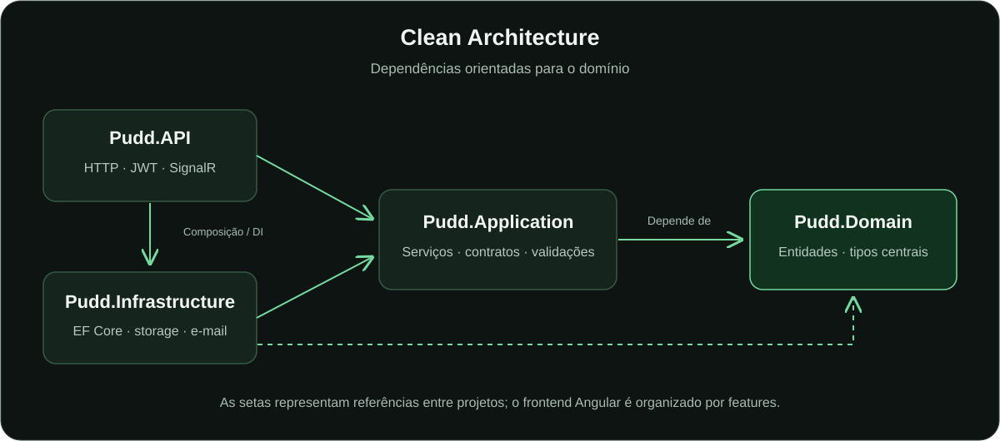
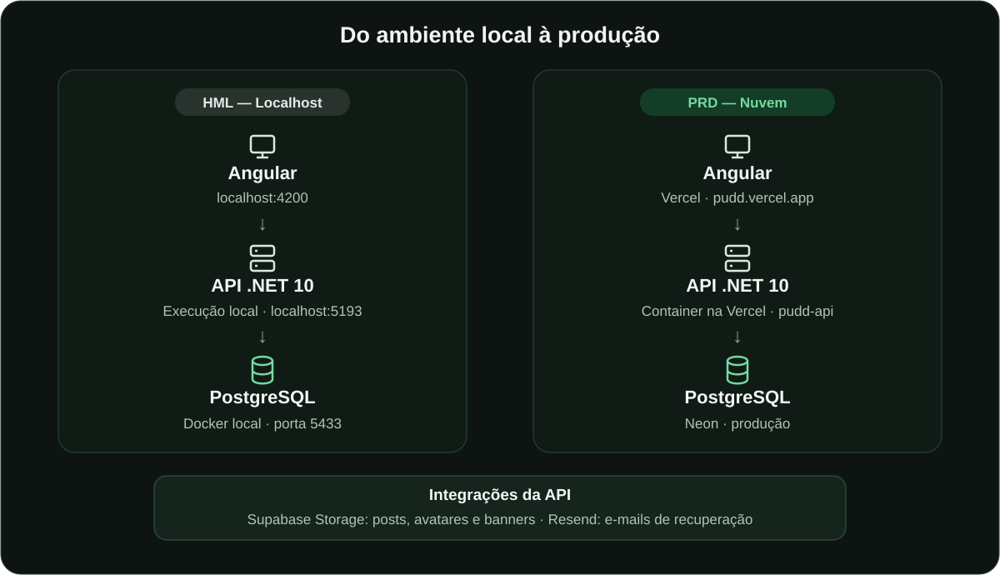
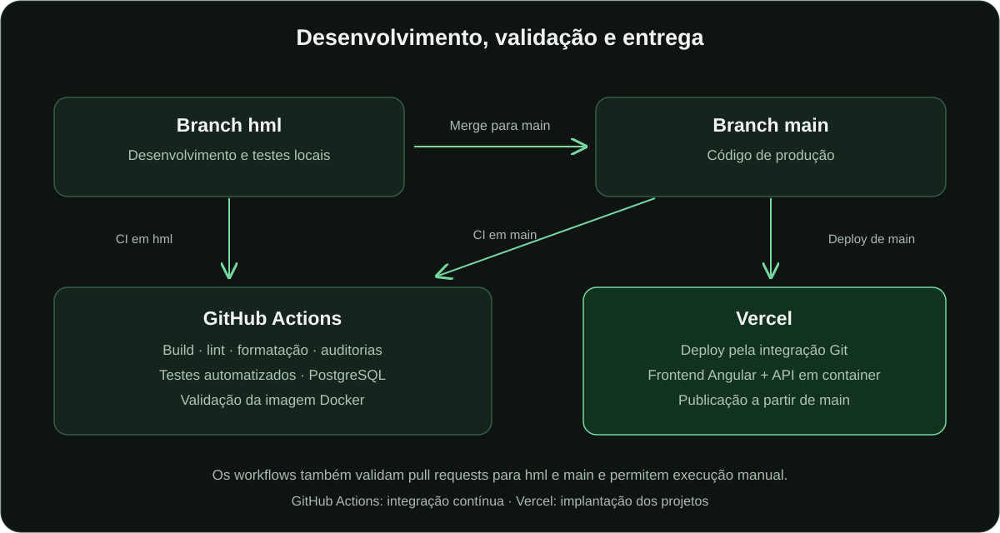

  

<h1 align="center">Pudd</h1>

Um espaço para compartilhar ideias, mostrar o que você cria e aprender em comunidade.

  <a href="https://pudd.vercel.app/">Acessar o Pudd</a> ·
  <a href="#arquitetura">Arquitetura</a> ·
  <a href="#novas-features-inclusive-a-sua">Sugerir uma feature</a>

## Sobre o projeto

O **Pudd** é uma plataforma de comunidade em que você pode criar um perfil, publicar textos e imagens, curtir, comentar e conhecer o que outras pessoas estão construindo. A interface funciona no desktop e no celular, com temas claro e escuro, busca de perfis e espaço para enviar sugestões ou informar bugs.

Este é um **projeto de estudo**, desenvolvido para aplicar conhecimentos adquiridos no trabalho e explorar novas formas de pensar sobre software: arquitetura, segurança, experiência de uso, tratamento de falhas e entrega em produção.

**Experimente:** [pudd.vercel.app](https://pudd.vercel.app/)

## Tecnologias

  

| Parte | Tecnologias e responsabilidades |
| --- | --- |
| Frontend | Angular 21, TypeScript, PrimeNG e RxJS; organização por funcionalidades e interface responsiva. |
| Backend | C# e ASP.NET Core / .NET 10; API HTTP com injeção de dependências e validação com FluentValidation. |
| Persistência | Entity Framework Core e Npgsql; PostgreSQL 18 no Docker local e PostgreSQL no Neon em produção. |
| Imagens | Supabase Storage para publicações, avatares e banners, com URLs assinadas. |
| Autenticação | JWT, autorização por claims e BCrypt para hash de senhas. |
| Comunicação | SignalR para notificações/presença e Resend para recuperação de senha por e-mail. |
| Qualidade e entrega | xUnit, Vitest, Playwright, ESLint, Prettier, Docker, GitHub Actions e Vercel. |

O acesso ao banco usa consultas parametrizadas pelo EF Core para prevenir SQL Injection. A API também aplica validação de entradas e limites de requisições. Na UI/UX, o projeto trabalha feedback visual, estados de carregamento, confirmações e navegação adaptada a telas menores.

## Arquitetura

O backend segue **Clean Architecture**, com dependências orientadas para o domínio. As regras e os contratos da aplicação ficam separados dos detalhes de HTTP, banco de dados e serviços externos. O frontend Angular é organizado por **features**.

| Projeto | Responsabilidade |
| --- | --- |
| `Pudd.Domain` | Entidades e tipos centrais do domínio. |
| `Pudd.Application` | Serviços de aplicação, regras, contratos, interfaces e validações. |
| `Pudd.Infrastructure` | EF Core, migrations, repositórios, JWT, hash de senhas e integrações com Supabase e e-mail. |
| `Pudd.API` | Controllers, autenticação/autorização HTTP, SignalR, tratamento de erros e composição das dependências. |
| `Pudd.Tests` | Testes unitários e de integração do backend. |
| `WEB/src/app/features` | Telas e recursos de autenticação, posts, comentários, perfil, administração e feedback. |

O fluxo de uma operação parte da interface Angular, chega ao controller e passa pelo serviço de aplicação. O serviço utiliza os contratos implementados pela infraestrutura para acessar o PostgreSQL ou serviços externos.

### Ambientes: homologação e produção

| Ambiente | Frontend | API | Banco |
| --- | --- | --- | --- |
| **HML / local** | Angular em `localhost:4200` | .NET 10 em `localhost:5193` | PostgreSQL no Docker, porta local `5433`. |
| **PRD / nuvem** | Angular na Vercel: [pudd.vercel.app](https://pudd.vercel.app/) | .NET 10 em container na Vercel: `pudd-api.vercel.app` | PostgreSQL no Neon. |

Neste projeto, a homologação corresponde à execução local associada à branch/configuração `hml`. A configuração Angular `main` utiliza a API de produção. O Supabase armazena os arquivos; os dados relacionais ficam no PostgreSQL.

## CI/CD: de `hml` para `main`

- **`hml`**: desenvolvimento, testes e validação local das alterações.
- **`main`**: branch de produção, que recebe as alterações por merge.
- **GitHub Actions**: executa a integração contínua em pushes e pull requests destinados a `hml` e `main`, além da execução manual.
- **Vercel**: a integração Git publica os projetos de frontend e API a partir de `main`.

| Pipeline | Validações implementadas |
| --- | --- |
| [WEB](.github/workflows/ci-pudd-web.yml) | Instalação pelo lockfile, ESLint, Prettier, auditoria de dependências, tipos dos testes, testes Angular e build de produção. |
| [API](.github/workflows/ci-pudd.yml) | Restore e auditoria NuGet, build Release, testes unitários/de integração com PostgreSQL e validação/build da imagem Docker com usuário sem privilégios de root. |

O deploy fica a cargo da integração Git da Vercel. As migrations de produção fazem parte da preparação da implantação e precisam ser aplicadas ao banco correspondente.

## Novas features, inclusive a sua!

O Pudd continua em desenvolvimento. **Novas features serão feitas, e a sua ideia pode fazer parte das próximas versões!**

Tem uma sugestão ou encontrou algo que pode melhorar? Acesse o Pudd e use **Informar bug** ou a opção de **Sugestão** no formulário de feedback. Você também pode acompanhar a área **Em breve** para conhecer as novidades planejadas.

**Mande sugestões para crescermos a comunidade juntos.** 🐾

---

Desenvolvido por <strong><a href="https://github.com/GabrielCost4">Gabriel Costa</a></strong>

